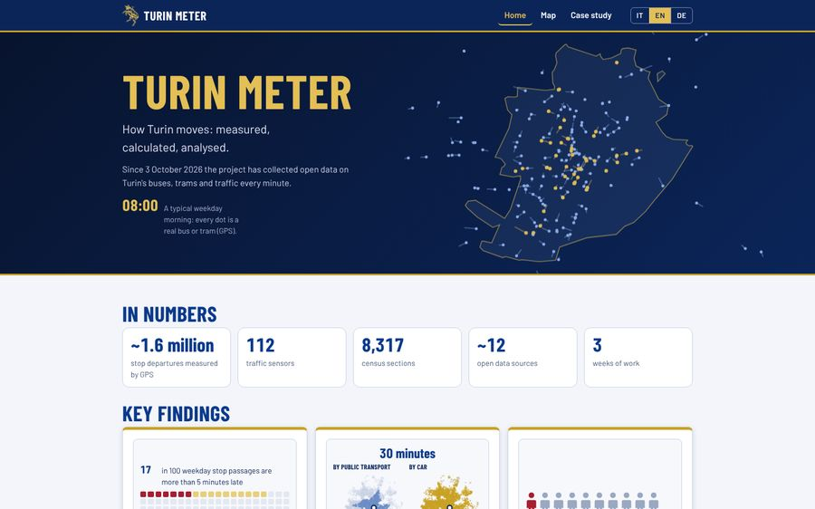

# Turin Meter

**How Turin moves: measured, calculated, analysed.** · An independent project by Leonardo Campese

[](https://campeseleonardo-tech.github.io/turin-meter/?lang=en) [](https://github.com/campeseleonardo-tech/turin-meter/actions/workflows/check.yml) [](LICENSE)

*Italiano: [README.it.md](README.it.md) · Deutsch: [README.de.md](README.de.md)*

[](https://campeseleonardo-tech.github.io/turin-meter/?lang=en)

## What it is

The project collects open data on the buses, trams and traffic of Turin every minute and combines them with the census, a travel survey and open maps.
Four concrete questions about the city's mobility get an answer, each with its method and its limits.
Only open data; the site, the map and the findings are in Italian, English and German.

## Key findings

<!-- RISULTATI-EN:INIZIO -->
1. **About 1 arrival in 15 is more than 10 minutes late**  
   How often are GTT vehicles late? → **6.7%** of weekday arrivals are more than 10 minutes late. [Open](https://campeseleonardo-tech.github.io/turin-meter/index.html?lang=en#p1)
2. **In the morning, public transport takes 1.9 to 2.4 times as long as the car**  
   In the morning, how much longer does it take by public transport than by car? → **1.9–2.4 times** the car's travel time, for morning car trips between different zones. [Open](https://campeseleonardo-tech.github.io/turin-meter/index.html?lang=en#p2)
3. **About 1 Turin resident in 10 lives in an area with more social difficulties and few services**  
   Who lives where services are few and social difficulties are high? → **79,598** residents in zones with more social difficulty and few services: 9.5% of residents of inhabited zones. That is 1.7 times what you would expect by chance. [Open](https://campeseleonardo-tech.github.io/turin-meter/index.html?lang=en#p3)
4. **About 2 in 3 important stops lack enough spaces to leave the car**  
   Can people driving in from outside find a place to leave the car near an important stop, and continue by public transport? → **179** important stops out of 274 lack enough parking within 400 metres on foot. [Open](https://campeseleonardo-tech.github.io/turin-meter/index.html?lang=en#p4)
<!-- RISULTATI-EN:FINE -->

Every finding explains on its card how the number is calculated, and its limits. Car times are shown as a range.

## How it works

A Raspberry Pi at home reads the open data of GTT and 5T every minute and saves them in an archive. Python scripts combine them with the other sources, and the pages are built from the results.


### In numbers

<!-- IN-NUMERI-EN:INIZIO -->
- **~1.6 million** stop departures measured by GPS · **112** traffic sensors · **8,317** census sections · **~12** open data sources
- **3** weeks of work · **485** tracked versions
<!-- IN-NUMERI-EN:FINE -->

## My role and the work with AI

I chose the questions, the sources, the rules and thresholds, and decided what to publish. The data collection and part of the Python analyses I wrote myself; for the rest AI worked as an accelerator, with several models and an automatic check on every delivery. The story is in the [case study](https://campeseleonardo-tech.github.io/turin-meter/progetto.html?lang=en).

## Data, licences and disclaimer

Open data only; the code is under the [MIT licence](LICENSE), the data keep the licence of their source: see [`DATA_LICENSES.md`](DATA_LICENSES.md) (also [in Italian](docs/it/LICENZE_DATI.md) and [in German](docs/de/DATENLIZENZEN.md)). Where a source has no explicit licence only aggregated values are published. TomTom is read by a program only to check the car estimate on 20 routes, and nothing from it is published beyond the summary of the check.

*Independent personal project: not affiliated with or endorsed by GTT, 5T, the City of Turin or any other organisation mentioned.*

## Limits

- A few weekdays of October 2026: the numbers describe that period, not a year.
- Only urban lines seen by GPS; one position per minute, so delays are a range.
- Car times come from an open model, checked against TomTom on 20 routes; they are not measured on single trips.
- No trains, no other operators; the vulnerability index is built by this project, not an official index, and is not income.
- Prices are those of one day.

## Method

The methods are documented in English only, in [`docs/en/METHODS.md`](docs/en/METHODS.md): collection, area, the open estimate of car times, the check against TomTom, and each finding (question, data, method, checks, limits, how to redo it).

## Rebuild the calculations

```
pip install -r requirements.txt     # public transport times (r5py) also need Java 21 or later
python scripts/scarica_dati.py      # large data from the GitHub Release (IMQ and OMI by hand: see docs/en/METHODS.md)
python scripts/rifai_tutto.py       # everything, in the right order (--elenco lists the phases, --riprendi resumes)
python scripts/prova_pagine.py      # check of the pages
```

## Map of the repository

The scripts, grouped by phase, are described in [`scripts/README.md`](scripts/README.md).

## Contact

Leonardo Campese · [LinkedIn](https://www.linkedin.com/in/leocampese/) · [campese.leonardo@gmail.com](mailto:campese.leonardo@gmail.com)
